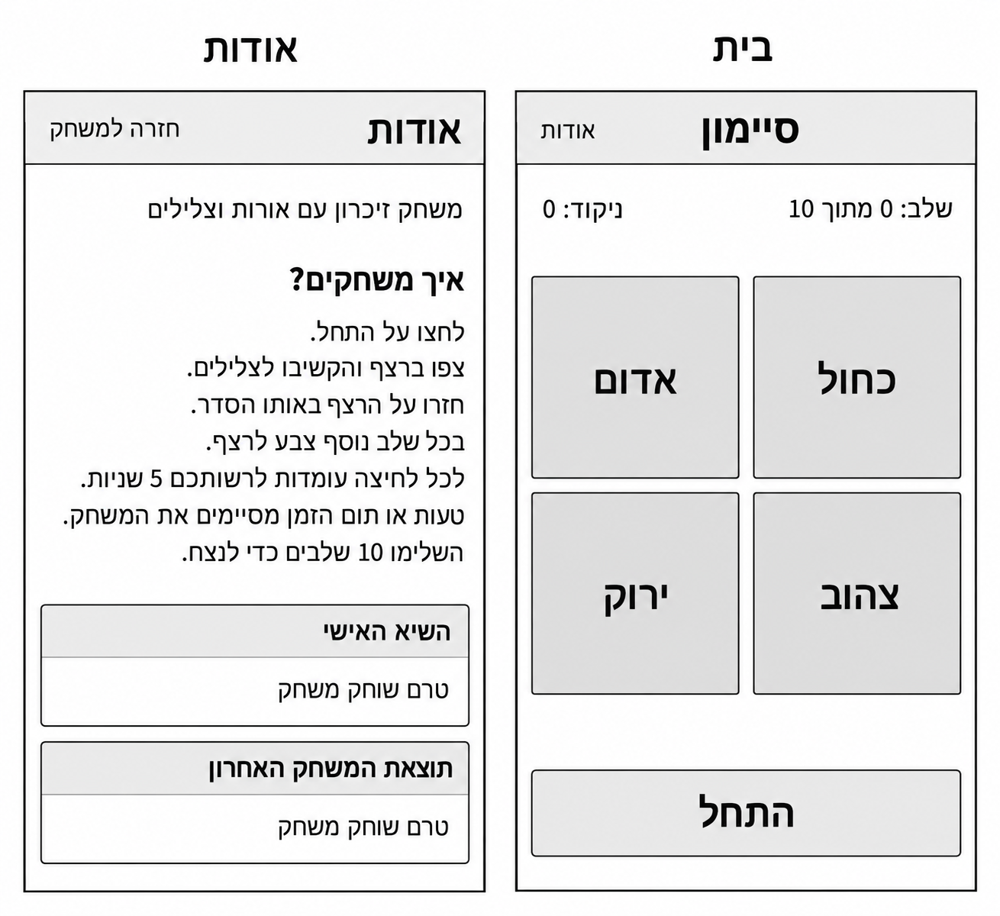
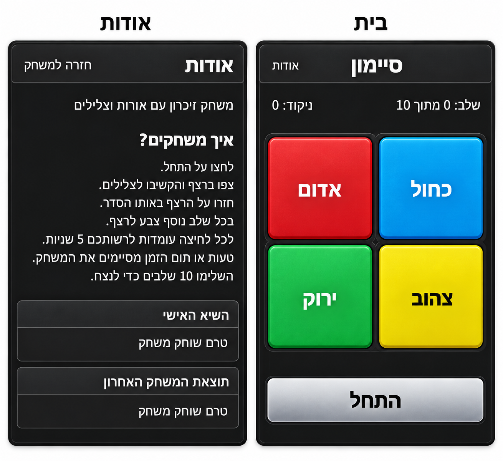
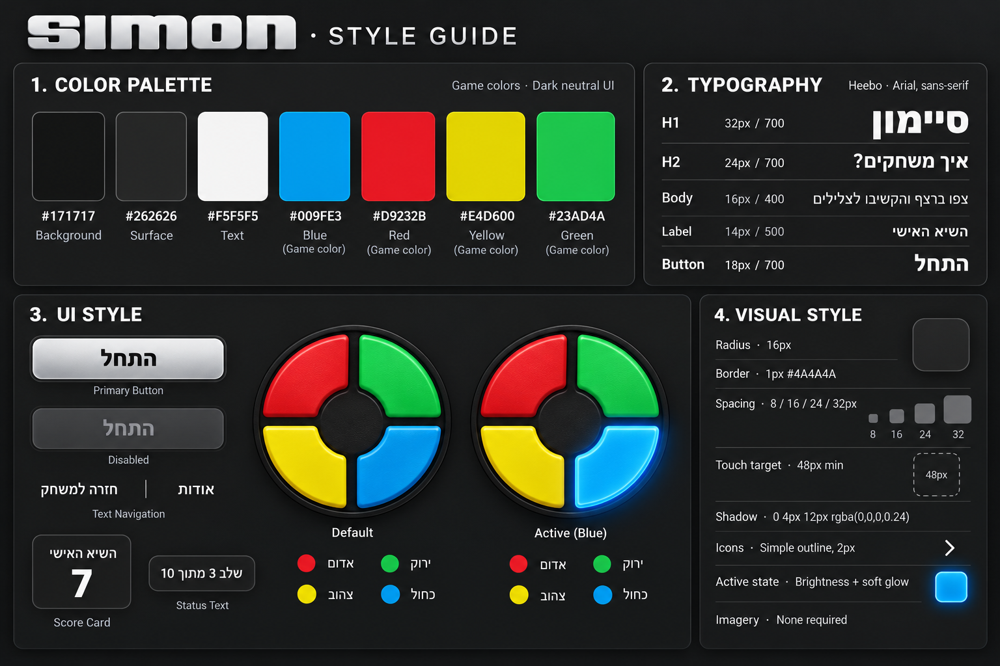

# DESIGN — משחק סיימון

תאריך: 18.10.2026

מסמך זה מתאר את מימוש העיצוב של שני מסכי האפליקציה. ה־PRD קובע את ההתנהגות; ה־Wireframes קובעים מבנה ותוכן; ה־Style Guide קובע את השפה החזותית; ה־Mockups מציגים את יישומה הסופי.

במקרה של הבדל חזותי: נשמרים המבנה והתוכן של ה־Wireframes, והסגנון של ה־Style Guide. בפרט, לוח המשחק נשאר Grid של ארבעה כפתורים כפי שמופיע ב־Mockups, ולא הופך ללוח עגול כפי שמודגם ב־Style Guide.

## 1. Screens — מסכי האפליקציה

### מבנה המסכים

הלוח מציג את מסך הבית מימין ואת מסך אודות משמאל. שני המסכים בעלי מסגרת ומידות תואמות. כותרות המסכים שמעל למסגרות הן תוויות תיעוד בלבד ואינן חלק מממשק האפליקציה.

### בית

**מטרת המסך:** התחלת משחק, צפייה ברצף וחזרה עליו באמצעות ארבעת כפתורי הצבע.

**מבנה ותוכן, מלמעלה למטה:**

- Header כהה: כותרת „סיימון” בצד ימין וקישור „אודות” בצד שמאל.
- שורת מצב: השלב בצד ימין והניקוד בצד שמאל. במצב ההתחלתי המוצג: „שלב: 0 מתוך 10” ו־„ניקוד: 0”.
- לוח מרכזי גדול ב־Grid של שתי שורות ושתי עמודות. הכפתורים מרובעים, בעלי פינות מעוגלות, מילוי צבעוני ומסגרת כהה; רווח כהה מפריד ביניהם.
- תווית צבע גדולה וממורכזת בכל כפתור, לפי הסידור הבא. מיקום הצבעים קבוע גם כאשר כיוון המסמך RTL.

| שורה | צד ימין | צד שמאל |
| --- | --- | --- |
| עליונה | כחול | אדום |
| תחתונה | צהוב | ירוק |

- כפתור ראשי רחב „התחל” מתחת ללוח, בגוון כסוף, עם טקסט כהה ומודגש. נשמר מרווח ברור בינו לבין הלוח.

**פעולות וניווט:** „התחל” מפעיל משחק; ארבעת הכפתורים משמשים להזנת הרצף; „אודות” פותח את מסך אודות. זמינות הפעולות והתנהגות המשחק נקבעות ב־PRD.

ה־Mockup מציג מצב התחלתי בלבד. בזמן משחק מתעדכנים ערכי השלב והניקוד, ומשוב התור והתוצאה נשאר בתוך אותו מסך לפי ה־PRD; אין להוסיף מסך תוצאה או להמציא פאנל נוסף מתוך תמונת המצב ההתחלתי. המקורות אינם מגדירים מיקום מדויק לכל הודעת מצב, ולכן אין לראות במיקום שלא שורטט מפרט חזותי סגור.

### אודות

**מטרת המסך:** קריאת תיאור והוראות המשחק וצפייה בשני נתוני הניקוד המקומיים.

**מבנה ותוכן, מלמעלה למטה:**

- Header תואם לבית: כותרת „אודות” מימין וקישור „חזרה למשחק” משמאל.
- תיאור קצר, מיושר לימין: „משחק זיכרון עם אורות וצלילים”.
- כותרת משנה מודגשת „איך משחקים?” ומתחתיה הוראות, מיושרות לימין, בשורות נפרדות עם ריווח קריא:

  1. „לחצו על התחל.”
  2. „צפו ברצף והקשיבו לצלילים.”
  3. „חזרו על הרצף באותו הסדר.”
  4. „בכל שלב נוסף צבע לרצף.”
  5. „לכל לחיצה עומדות לרשותכם 5 שניות.”
  6. „טעות או תום הזמן מסיימים את המשחק.”
  7. „השלימו 10 שלבים כדי לנצח.”

המספור ברשימה לעיל נועד לתיעוד; בממשק ההוראות מוצגות ללא מספור, כפי שמופיע ב־Mockup.

- שני כרטיסי ניקוד רחבים, זה מתחת לזה. כל כרטיס כולל אזור כותרת מודגש, קו מפריד ואזור ערך, כולם מיושרים לימין:

| כרטיס | כותרת | ערך במצב ההתחלתי המוצג |
| --- | --- | --- |
| עליון | השיא האישי | טרם שוחק משחק |
| תחתון | תוצאת המשחק האחרון | טרם שוחק משחק |

**פעולות וניווט:** „חזרה למשחק” מחזיר לבית. הכרטיסים וההוראות אינם אינטראקטיביים. ערכי הניקוד מתחלפים בהתאם לנתונים בפועל, ללא שינוי מבנה הכרטיסים.

### ניווט כללי והמראה הסופי

הניווט נעשה באמצעות קישורי הטקסט ב־Header: בית → „אודות”; אודות → „חזרה למשחק”. אין Bottom Navigation, תפריט נפתח או מסכים נוספים. השהיה וחידוש במהלך ניווט מתנהלים לפי ה־PRD.

## 2. Style Guide — השפה העיצובית

### Color Palette

| תפקיד | HEX | שימוש |
| --- | --- | --- |
| Background | `#171717` | רקע המסכים והבסיס הכהה סביב לוח המשחק |
| Surface | `#262626` | Header, כרטיסים ומשטחי UI כהים |
| Text | `#F5F5F5` | טקסט ראשי על רקעים כהים |
| Blue | `#009FE3` | כפתור „כחול” |
| Red | `#D9232B` | כפתור „אדום” |
| Yellow | `#E4D600` | כפתור „צהוב” |
| Green | `#23AD4A` | כפתור „ירוק” |
| Border | `#4A4A4A` | קווי מתאר ומפרידים עדינים |

צבעי המשחק הם צבעי בסיס. ב־Mockups מופיעים מעליהם מעברי גוון והברקות ליצירת עומק; אין להחליף את צבעי הבסיס בצבעים חדשים. תוויות הכחול, האדום והירוק בהירות, ותווית הצהוב כהה, בהתאם ל־Mockup. לגוון הטקסט הכהה לא הוגדר HEX נפרד במקור.

הכפתור הראשי כסוף עם Gradient בהיר ומסגרת כהה. צבעי הקצה המדויקים של ה־Gradient אינם מוגדרים במקורות; יש להתאים את מראהו ל־Mockup, בלי להציג ערכי צבע משוערים כ־Tokens מאושרים.

### Typography

משפחת הגופן המוגדרת ב־Style Guide היא **Heebo**, עם Fallback של `Arial, sans-serif`. הטיפוגרפיה בממשק עברית, ברורה וישרה; אין להשתמש בלוגו הלטיני הגדול שבלוח ה־Style Guide כתחליף לכותרת „סיימון”.

| שימוש | גודל מומלץ | Font Weight | דוגמה |
| --- | --- | --- | --- |
| H1 — כותרת מסך | 32px | 700 | סיימון / אודות |
| H2 — כותרת משנה | 24px | 700 | איך משחקים? |
| Body — תיאור והוראות | 16px | 400 | צפו ברצף והקשיבו לצלילים |
| Label — תווית | 14px | 500 | השיא האישי |
| Button — פעולה ראשית | 18px | 700 | התחל |

אלה ערכי היישום המומלצים המופיעים ב־Style Guide, ולא מידות הנמדדות מפיקסלי תמונת הלוח. ב־Mockups תוויות הצבע וכותרות כרטיסי הניקוד מודגשות; לא נקבע עבורן גודל עצמאי נוסף. יש לשמור על ההיררכיה והקריאות בלי להמציא מדרג טיפוגרפי נוסף. Line Height מדויק לא הוגדר; יש להשאיר בין שורות ההוראות מרווח שמונע צפיפות או חיתוך.

### UI Style

**כפתורי המשחק:** ארבעה כפתורים מרובעים במידות אחידות, עם פינות מעוגלות, מסגרת כהה עבה, קצה מואר בעדינות ותחושת משטח פלסטיק מוחשי. הכיתוב ממורכז בשני הצירים. אין Hub מרכזי או שינוי בצורת הלוח לעיגול.

**Active State:** ה־Style Guide מגדיר הגברת בהירות ו־Soft Glow, בנוסף למשטח הצבעוני. האפקט מוגבל לכפתור שמופעל, כך שהבדל בין מצב רגיל להארה יהיה ברור. ה־Mockup מייצג מצב רגיל ואינו מחייב Glow קבוע סביב כל הכפתורים.

**כפתור „התחל”:** כפתור רחב בגוון כסוף ובפינות מעוגלות, עם משקל טיפוגרפי בולט. מצב Disabled המודגם ב־Style Guide משתמש בגוון כהה ומופחת ניגודיות; הוא מייצג חוסר זמינות ואינו פעולה חדשה.

**כרטיסי ניקוד:** Surface כהה, Border דק ובהיר יחסית לרקע, פינות מעוגלות וחלוקה אופקית בין כותרת לערך. במימוש מסך אודות יש להעדיף את שני הכרטיסים הרחבים שב־Mockup על פני כרטיס הדוגמה הקטן עם הערך „7” ב־Style Guide.

**ניווט:** קישורי טקסט בהירים בתוך ה־Header, ללא כפתור צבעוני או אייקון נוסף. אין טפסים, שדות קלט או תפריטי בחירה במוצר, ולכן אין להוסיף להם רכיבים מתוך רשימת רכיבי UI כללית.

**אייקונים:** ה־Style Guide מציין Simple Outline בעובי 2px. בשני המסכים הסופיים אין צורך באייקון ניווט נוסף; אין להוסיף את סמל ההדגמה שב־Style Guide לממשק ללא בסיס ב־Mockups.

### Visual Style

- **אווירה:** משחק פיזי קלאסי בתרגום דיגיטלי — בסיס Graphite, צבעי משחק רוויים, גימור כסוף לפעולה הראשית ועומק מתון. ללא תמונות, איורים או אלמנטים דקורטיביים נוספים.
- **צורות:** כפתורים וכרטיסים בעלי פינות מעוגלות. ערך ה־Radius המומלץ הוא 16px. הלוח עצמו מלבני ומחולק ל־2×2, בהתאם למבנה המאושר.
- **קווי מתאר:** ברכיבי Surface קו של 1px בגוון `#4A4A4A`. כפתורי המשחק מוסיפים מסגרת כהה בולטת והברקה כפי שמופיע ב־Mockup; עובי נפרד למסגרת זו לא הוגדר.
- **Shadow:** ערך הייחוס ב־Style Guide הוא `0 4px 12px rgba(0,0,0,0.24)`. להשתמש בו לעומק עדין, ולהבחין בינו לבין Glow של Active State.
- **Spacing:** מדרג המרווחים הוא 8 / 16 / 24 / 32px. יש להשתמש בו בעקביות לריווח פנימי, הפרדה בין קבוצות תוכן ושולי המסך; אין במקורות שיוך מספרי מדויק לכל מרווח.
- **Layout:** שני Headers עקביים; תוכן בטור אחד; בבית Grid מרכזי ובאודות הוראות וכרטיסים מוערמים. שומרים על רוחב זמין נוח למגע ועל גובה מסך טלפון, בלי להאריך את המסך באופן מלאכותי כדי להתאים לתמונת הלוח.
- **Touch Targets:** גודל מינימלי של 48px לפי ה־Style Guide. לוח הצבעים והפעולה הראשית גדולים מכך; גם קישורי ה־Header צריכים אזור לחיץ נוח בלי להגדיל בהכרח את הכיתוב.
- **מסך קטן:** התוכן רשאי לזרום ולהישבר לשורות; אם מסך אודות אינו נכנס ל־Viewport, מאפשרים גלילה אנכית במקום לחתוך תוכן או לכווץ את הגופן. אין תכנון נפרד ל־Tablet או ל־Desktop.

### שפה וכיווניות

כל טקסט המופיע בממשק הוא בעברית, עם RTL ברמת המסך. כותרות ותוכן אודות מיושרים לימין; קישורי הניווט נשארים בצד שמאל כפי שנקבע ב־Wireframes. תוויות כפתורי המשחק והכפתור הראשי ממורכזות.

מספרים נשמרים בסדר קריא בתוך המשפט העברי, למשל „שלב: 0 מתוך 10”. אין להפוך את סדר הספרות או לשקף את מיקומי הצבעים בעת החלת RTL. כותרות הקטגוריות באנגלית ב־Style Guide הן תיעוד עיצובי בלבד ואינן טקסטים המיועדים לממשק.
